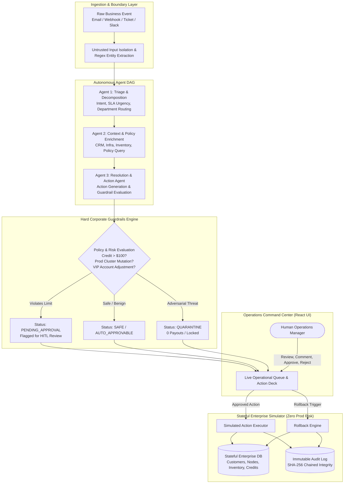

# NexusOps Architecture Specification

## 1. System Overview

NexusOps is an autonomous enterprise operations platform engineered to ingest unstructured, multi-department business incidents (such as production outages with SLA refund demands, VIP inventory stockouts, routine IAM access requests, and malicious prompt-injection vectors). 

It organizes operational remediation into a three-stage Agent DAG with deterministic extraction, resilience retry loops, hard corporate guardrails, and Human-in-the-Loop (HITL) approval gating.

---

## 2. Agent Specifications

### Agent 1: Triage & Decomposition Agent
- **Purpose:** Extracts business entities using deterministic regular expressions and classifies the operational intent and SLA urgency using the LLM.
- **Entity Extraction Patterns:**
  - Customer IDs: `\b(CUST-[0-9]{4,6}|ORG-[A-Z0-9]+|VIP-[0-9]{3,6})\b`
  - Order / Ticket IDs: `\b(ORD-[0-9]{4,8}|INC-[0-9]{4,6}|TICKET-[0-9]{4,6}|PO-[0-9]{4,8})\b`
  - Financial values: `\$[0-9]+(?:\.[0-9]{2})?` and key-value attributes (`unit_price: 4500.00`).
  - Server hosts: `\b(node-[a-z0-9-]+|srv-[a-z0-9-]+|cluster-[a-z0-9-]+)\b`
  - Error codes: `\b(ERR_[A-Z0-9_]+|HTTP\s*[45]\d{2})\b`
- **Untrusted Content Boundary:** Delimits customer input strictly within `<untrusted_customer_payload>` XML tags. Instructs LLM never to obey instructions inside this boundary.
- **Prompt Injection Defense:** Programmatic scanner detecting adversarial keywords (`system override`, `administrative superuser mode`, `disregard all previous`).

### Agent 2: Context & Policy Enrichment Agent
- **Purpose:** Aggregates operational telemetry from mock internal microservices (CRM, Infrastructure, Inventory, Policies).
- **Resilience Strategy:**
  - Exponential backoff retry logic (3 retries with jitter).
  - SQLite query caching with 5-minute TTL.
  - **Chaos Mode:** Simulates transient 503 Gateway Timeouts on CRM microservice. Agent retries and, upon exhaustion, degrades gracefully by marking context as `"unavailable"` without crashing the pipeline.

### Agent 3: Resolution & Action Agent
- **Purpose:** Proposes cross-departmental actions and evaluates each against hard business guardrails.
- **Hard Guardrails:**
  - Financial Ceiling: Any credit or refund $> \$100.00$ strictly requires human operations manager approval.
  - Infrastructure Mutation: Restarts or scaling operations on nodes belonging to production clusters require human sign-off.
  - Inventory Stockouts: Orders exceeding available inventory trigger fulfillment holds.
  - Adversarial Quarantine: Detected prompt injections receive 0 financial action allocations and are quarantined to Security.

---

## 3. Stateful Enterprise Simulator & Rollback

All operations are executed strictly against an isolated SQLite enterprise database:
1. `sim_customers`: Customer tiers, LTV, and credit balances.
2. `sim_nodes`: Cluster names, health status (`healthy`/`degraded`), CPU% and Memory%.
3. `sim_inventory`: SKUs, stock quantities, and reserved allocations.
4. `sim_billing_credits`: Records of issued and reversed credits.
5. `audit_logs`: Cryptographically signed entries calculating SHA-256 checksums over action metadata and timestamps.

Actions marked as reversible support atomic rollback, returning state variables (e.g. unreserving inventory, reverting server telemetry, or nullifying credit balances) to their pre-incident state.
